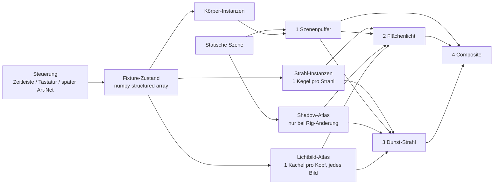
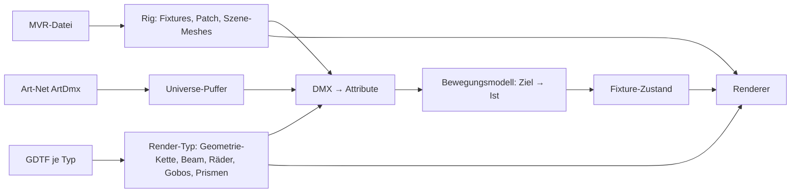

# Spec: Volumetrischer Movinghead-Visualizer (Prototyp)

Stand: 2026-10-30 · Status: Python-Prototyp lauffähig (Demo + manueller Modus) · Rust-Port in [rust/](rust/) mit voller Parität (siehe 12.) · Nächster Schritt: Art-Net-Visualizer mit MVR/GDTF (siehe 13. und [PLAN.md](PLAN.md))

## 1. Ziel und Scope

Echtzeit-Visualisierung von Movingheads für eine spätere Art-Net-Simulation:
volumetrische Strahlen im Dunst, Gobos, Gobo-Rad, Prismen, Projektion auf Flächen, Schatten.

- **Ziel-Skalierung:** 100–200 Scheinwerfer (bis ~600 Strahlen mit Prisma).
- **Ziel-Hardware:** 30–40 Köpfe flüssig auf integrierter GPU; 200 auf dedizierter GPU. Reduzierte Qualität erlaubt.
- **Plattformen:** Windows, Linux, **macOS** (daher OpenGL 3.3 Core, siehe 2.).
- **Nicht im Prototyp:** Art-Net, GDTF/MVR, UI, Modell-Import, Godot-Port (siehe Roadmap). Art-Net, GDTF/MVR, UI und Modell-Import sind für den Rust-Visualizer geplant (siehe 13.).

## 2. Technik und Constraints

| Komponente | Rolle |
|---|---|
| Python 3.13 | Host, Steuerung, Datenmodell |
| pygame | Fenster, Tastatur |
| moderngl | dünne OpenGL-Schicht (Buffer, Texturen, Shader, Draw-Calls) |
| numpy | Fixture-Zustand + vektorisierte Mathematik |
| Pillow | Gobo-PNGs laden, Screenshots |

- **OpenGL 3.3 Core, forward-compatible:** kein Compute, keine SSBOs, kein Layered Rendering nötig. Nur VBO-Instancing, MRT, Float-Targets, Texture-Arrays, 3D-Texturen.
- **Die Bibliotheken liefern keine Volumetrik.** Alle Lichteffekte sind eigene GLSL-Shader in [shaders/](shaders/).
- Setup: `py -3.13 -m venv .venv` → `.venv\Scripts\python.exe -m pip install -r requirements.txt` → `python tools\make_gobos.py`.

## 3. Architektur

**Kernprinzip:** Steuerung und Renderer sind entkoppelt. Alle Steuerquellen schreiben nur in den Fixture-Zustand; der Renderer zeichnet den Zustand.

| Datei | Inhalt |
|---|---|
| [fixtures.py](fixtures.py) | `FIXTURE_DTYPE`, `create_fixtures()`, `aim_at()`, `build_beam_instances()`, `build_body_instances()`, `build_light_instances()` |
| [renderer.py](renderer.py) | `Renderer`, Qualitätsstufen, Shadow-Atlas, Lichtbild-Atlas, Render-Passes |
| [mathutil.py](mathutil.py) | Matrizen, Rotationen (vektorisiert), Meshes (Box, Kegel, Fixture-Körper) |
| [main.py](main.py) | Bühne, Rig-Layout, Demo-Zeitleiste `animate()`, `ManualControl`, CLI |
| [shaders/lightimage.frag](shaders/lightimage.frag) | `goboWheel()`, Zusammensetzen der Räder zum Lichtbild |
| [shaders/common.glsl](shaders/common.glsl) | `beamMask()`, `lightImage()`, `coneInterval()`, `shadow()`, Rekonstruktion |
| [shaders/beam.frag](shaders/beam.frag) | Flächenlicht (`SURFACE`) und Dunst (`VOLUME`) |

## 4. Konventionen

- Welt: rechtshändig, **Y oben**, Boden y=0, Rückwand z=−8, Publikum Richtung +Z.
- **Strahlraum:** Ursprung an der Linse, Strahl entlang **+Z**, Basis-Spalten `ax, ay, az`.
- Fixture-Rahmen: Tilt 0 = Strahl zeigt weg von der Basis (lokal +Y). Hängend = Rotation 180° um X.
- Beam-Basis: `Mount · Ry(pan) · Rx(tilt) · Rx(−90°)`.
- Hängende Köpfe: **negativer Tilt** hebt den Strahl Richtung Publikum.
- Linse/Apex: `pos + az · 0.14 m`. Shadow-Ursprung: Kopfmitte `pos` (bewegungsunabhängig).
- Mesh-Winding: CCW von außen (wird von `_oriented()` erzwungen); Beam-Passes hängen davon ab.

## 5. Datenmodell (`FIXTURE_DTYPE`)

| Feld | Typ | Bedeutung |
|---|---|---|
| `pos` | 3×f4 | Kopfmitte (Tilt-Achse), Welt |
| `hanging` | bool | Montage |
| `pan`, `tilt` | f4 | Grad |
| `dimmer` | f4 | 0..1 (Strahlen mit ≤ 0.001 werden nicht gezeichnet) |
| `color` | 3×f4 | linear RGB 0..1 |
| `zoom` | f4 | voller Strahlwinkel, Grad |
| `focus` | f4 | 0..1, wählt die scharfe Ebene: Rad 1 scharf bei 0.0, Rad 2 bei 0.3 (`WHEEL_PLANES`) |
| `gobo` | f4 | **Radposition** Rad 1: 0 offen, n = Gobo n−1, Nachkommastellen = Rad fährt |
| `gobo_rot` | f4 | Grad |
| `gobo2` | f4 | Radposition Rad 2 (gleiche Konvention, gleiche Gobo-Bibliothek) |
| `gobo2_rot` | f4 | Grad (Demo/Manuell: 0 = statisches Rad) |
| `prism` | i4 | Facetten, 0 = aus |
| `prism_rot` | f4 | Grad |
| `prism_spread` | f4 | Ablenkung pro Facette, Grad |

**Strahl-Instanz (22 floats):** apex 3, Basis 9, Kegel 3 (tan halber Winkel, Länge 40 m, Fokus), Farbe 3 (inkl. Dimmer/Facettengewicht), Shadow 4 (Ursprung, Slot = Kopf-Index für Shadow- und Lichtbild-Kachel).

**Lichtbild-Instanz (7 floats, pro Kopf):** Slot 1, Rad 1 (Position, Rotation rad, Unschärfe) 3, Rad 2 3. Unschärfe = `|focus − Ebene| · FOCUS_BLUR (8)` Mip-Stufen.

## 6. Render-Pipeline

| # | Pass | Auflösung | Inhalt |
|---|---|---|---|
| 0 | Shadow-Atlas | — | nur wenn `fixtures["pos"]` sich ändert |
| 0b | Lichtbild-Atlas | 128–256² pro Kopf | jedes Bild, 1 instanzierter Draw-Call für alle Köpfe |
| 1 | Szenenpuffer | voll | Albedo (RGBA8), Normale (RGBA16F), Emissive→Lichtpuffer (RGBA16F), Tiefe |
| 2 | Flächenlicht | voll | Kegel-Instanzen, additiv, nur Rückseiten |
| 3 | Dunst | 33–75 % | Kegel-Instanzen, additiv, nur Rückseiten, Raymarch |
| 4 | Composite | voll | Ambient·Albedo + Licht + Dunst (bilinear) → ACES → Gamma → Dither |

### 6.1 Strahl als Light-Volume
- Pro Strahl ein instanzierter, geschlossener Kegel (24 Segmente; Radius × `1.02 / cos(π/24)`, damit das Polygon den analytischen Kegel abdeckt).
- **Nur Rückseiten** (`front_face = "cw"` + Culling), Depth-Test aus → genau ein Fragment pro abgedecktem Pixel, auch wenn die Kamera im Kegel steht.
- Ein Draw-Call für alle Strahlen. **Kosten ∝ Bildfläche der Strahlen**, nicht ∝ Anzahl Köpfe.

### 6.2 Gobo-Projektion (`beamMask`)
- Punkt im Strahlraum `l` → $uv = l_{xy} / (l_z \cdot \tan\frac{\theta}{2})$; Strahlrand bei $|uv| = 1$.
- Weiche Kante (analytisch): `smoothstep` mit Breite `mix(0.03, 0.35, focus)`.
- Muster: **ein** Zugriff auf die Lichtbild-Kachel des Kopfes (`lightImage()`), bilinear, an den Kachelrand geklemmt.
- Identische Funktion für Dunst und Flächen → Muster im Strahl und am Boden passen zusammen.

### 6.3 Lichtbild pro Kopf und Gobo-Räder
- Pro Kopf eine Kachel im **Lichtbild-Atlas** (R8; 256² low/medium, 512² high; Kachel wird halbiert, falls der Atlas max. 8192² nicht reicht). 128² erzeugt sichtbare Treppen an Gobo-Kanten in der Bodenprojektion (bilineare Vergrößerung).
- Wird **jedes Bild** neu zusammengesetzt (1 instanzierter Draw-Call): Kachel = `goboWheel(Rad 1) × goboWheel(Rad 2)`.
- **Beam-Shader lesen immer genau 1 Wert pro Schritt**, egal wie viele Ebenen im Kopf sitzen. Weitere Ebenen (Farbrad, Animationsrad, Iris, Frost) kommen nur in diesen Pass.
- `goboWheel`: Slots linear im Abstand `SLOT_PITCH = 2.3` Aperturradien, Slot-Loch Radius 1.05 (dazwischen Metall). Slot 0 = offen, Slot n = Texturebene n−1; zyklisch (`u_wheel_slots = Gobos + 1`). Slots überlappen nie → 1 Zugriff pro Rad, auch während des Durchlaufs.
- **Morph-Fokus:** jedes Rad wird mit eigener Unschärfe gelesen (`u_lod_base = log2(256 / Kachel)` + `|focus − Ebene| · 8`).
- Alle Gobos in einem `sampler2DArray` (256², Mipmaps). **Anzahl der Gobos kostet keine Leistung**, nur Speicher (~85 KB/Gobo).
- Vereinfachungen: lineare statt bogenförmige Radbewegung; beide Räder nutzen dieselbe Gobo-Bibliothek; Lichtbild ohne Mipmaps (Kachelauflösung = effektive Schärfe).

### 6.4 Prisma
- Prisma = **zusätzliche Strahl-Instanzen**: Facette k kippt die Achse um `prism_spread` in Richtung `prism_rot + k·360°/n`; Gewicht 1/n.
- Kein Sonderfall im Shader. Kosten wie n Strahlen. Alle Facetten teilen Lichtbild und Shadow-Map des Kopfes.

### 6.5 Volumetrik (Pass 3)
Physikalisches Bild: Dunst streut einen Teil des Lichts zur Kamera. Pro Pixel:
1. Sehstrahl Kamera → Pixel.
2. `coneInterval()`: analytischer Schnitt mit dem endlichen Kegel → $[t_0, t_1]$, begrenzt durch Szenentiefe.
3. N Schritte mit Interleaved-Gradient-Noise-Jitter.
4. Pro Schritt: $\text{Maske} \cdot \text{Schatten} \cdot \text{Dichte} \cdot HG(\cos\theta, g) / (d^2 + 0.3)$
5. Ergebnis × Farbe × `dt · HAZE_DENSITY · VOLUME_GAIN · exp(−EXTINCTION · t₀)`.

- Henyey-Greenstein mit g = 0.35 (Vorwärtsstreuung → Strahlen Richtung Kamera heller).
- Dichte: Grunddunst × animiertes, kachelbares 3D-Rauschen (32³, 2 Oktaven, Drift).
- Vereinfachung: keine Extinktion zwischen Strahlen (rein additiv).

### 6.6 Flächenlicht (Pass 2)
Weltposition aus Tiefe → Maske × Schatten × max(N·L, 0) × Albedo × Farbe × `SURFACE_GAIN / d²`.

### 6.7 Schatten
- Pro Kopf **Rundum-Shadow-Map** (6 Würfelseiten, 90°) um die Kopfmitte, gespeichert als **Distanz** (R16F) in **einem 2D-Atlas**.
- Aufbau ohne Tiefenpuffer: Atlas mit 60000 löschen, **MIN-Blending** behält das nächste Hindernis.
- **Nur Neuaufbau bei Rig-/Szenenänderung.** Pan/Tilt/Zoom/Prisma/Gobo kosten nichts.
- Lookup: Hauptachse → Würfelseite → Kachel; halbes Texel Abstand zum Kachelrand.
- Bias: `0.03 + 0.01·d`; Flächen zusätzlich Normal-Offset `0.02 + 0.01·d`.
- Kachelgröße nach Qualität (128/128/256), automatisch halbiert, falls Atlas (max. 8192²) nicht reicht.
- Nur statische Szene wirft Schatten (keine Fixture-Körper, keine beweglichen Objekte).

### 6.8 Qualitätsstufen
| Stufe | Dunst-Auflösung | Schritte | Rauschen | Shadow-Kachel | Lichtbild-Kachel |
|---|---|---|---|---|---|
| low | 33 % | 12 | aus | 128 | 256 |
| medium | 50 % | 24 | an | 128 | 256 |
| high | 75 % | 48 | an | 256 | 512 |

**Dynamische Auflösung** (`--target-fps`, Standard 60, 0 = aus): Liegt die FPS unter 95 % des Ziels, sinkt die Dunst-Auflösung alle 0.5 s um 15 % (min. 20 %); über 130 % steigt sie um 10 % bis zur Preset-Grenze. Der Dunst-Puffer wird einmal in Preset-Größe angelegt; gerendert wird in einen Teilbereich (Viewport), das Composite liest nur diesen Teil → keine Neuallokation. Nur der Dunst-Pass skaliert (er dominiert die Kosten); Flächen bleiben in voller Auflösung. Unter ~30 % werden schmale Strahlen leicht treppig.

### 6.9 Tuning-Konstanten ([renderer.py](renderer.py))
`HAZE_DENSITY 0.1`, `SURFACE_GAIN 50`, `VOLUME_GAIN 60`, `AMBIENT 0.006`, `EXTINCTION 0.02`, `HG_G 0.35`. Werte frei gewählt, nicht photometrisch.

## 7. Demo und Steuerung ([main.py](main.py))

**CLI:** `--quality low|medium|high`, `--fixtures N` (Rig mit 25 Köpfen pro Traverse, Traversen im Abstand 1.4 m), `--manual`, `--target-fps F`, `--screenshot FILE --time T`.

**Demo-Zeitleiste (38 s Loop):** 0–6 s offen · 6 s Gobo 1 · 8.5–13 s **Rad 2 dazu mit Morph-Fokus** (9.5–12.5 s: Rad 1 scharf → Rad 2 scharf → zurück) · 13–28 s Prisma (ungerade Köpfe invertiert) · 20 s Gobo 2 · 20–26 s Zoom 14→24° · 28 s Rad zurück auf offen · 29–37 s **Blender**: Fächer-Schwenk auf Augenhöhe übers Publikum, Zoom 4°, kein Gobo/Prisma.
Bei mehreren Köpfen bekommt jeder einen individuellen Zustand (Phase, Gobo, Drehrichtung/-tempo, Prisma, Farbe), damit kein Strahl Arbeit mit einem anderen teilt.

**Pfeiltasten** (beide Modi): Pan/Tilt-Offset, 60°/s.

**Manueller Modus** (`--manual`, alle Köpfe gemeinsam):

| Taste | Funktion |
|---|---|
| Pfeile | Pan / Tilt |
| G | nächster Slot Rad 1 (Rad fährt 0.35 s/Slot, vorwärts) |
| H | nächster Slot Rad 2 |
| Q / E | Gobo-Rotation Rad 1 langsamer / schneller (±15°/s pro Druck, dreht durchgängig) |
| R / F | Fokus (Rad 1 scharf bei 0.0, Rad 2 bei 0.3) |
| P | Prisma rein/raus |
| A / D | Prisma-Rotation langsamer / schneller (±15°/s pro Druck, dreht durchgängig) |
| W / S | Zoom 2–60° |
| C | nächste Farbe |

## 8. Messwerte

Intel(R) Graphics (iGPU), 1280×720, Mittel über 100–300 Frames inkl. CPU-Anteil, ohne VSync.

| Szenario | Köpfe | Strahlen | Qualität | ms/Frame | FPS |
|---|---|---|---|---|---|
| synchron, alle mit Prisma | 1 | 3 | high | 2.62 | ~380 |
| synchron, alle mit Prisma | 40 | 120 | low | 2.17 | ~460 |
| synchron, alle mit Prisma | 40 | 120 | medium | 3.32 | ~300 |
| synchron, alle mit Prisma | 200 | 600 | medium | 13.40 | ~75 |
| individuell, ohne Schatten | 40 | 80 | low | 1.83 | ~550 |
| individuell, ohne Schatten | 40 | 80 | medium | 2.88 | ~350 |
| individuell, ohne Schatten | 200 | 400 | low | 5.11 | ~195 |
| individuell, ohne Schatten | 200 | 400 | medium | 11.42 | ~88 |
| Gobo-Rad im Durchlauf / eingerastet | 200 | — | medium | 12.96 / 13.39 | — |
| **mit Schatten** | 40 | — | low | 2.13 | ~470 |
| **mit Schatten** | 40 | — | medium | 3.61 | ~280 |
| **mit Schatten** | 50 | — | high | 11.17 | ~90 |
| **mit Schatten** | 200 | — | medium | 15.82 | ~63 |
| **mit Schatten** | 200 | — | high | 46.50 | ~22 |
| **Lichtbild**, Rad 2 offen / beide Räder | 200 | — | medium | 15.19 / 15.19 | ~66 |
| Lichtbild-Kachel 128 / 256 / 512 | 200 | — | medium | 15.26 / 16.04 / 19.13 | |
| **Dynamische Auflösung**, Ziel 60 FPS | 200 | — | high | ~25 → ~58–70 FPS nach ~3 s (Dunst 75 % → 24–28 %) | |

Shadow-Atlas-Aufbau (einmalig): 4–41 ms. Schatten kosten **+15–40 %** Frame-Zeit. Lichtbild: zweites Rad kostet **nichts messbar**; der Lichtbild-Pass ist im Gesamtwert enthalten (200 Köpfe medium: 15.19 ms vs. 15.82 ms vorher).

## 9. Erkenntnisse und Entscheidungen

1. **Light-Volume-Instancing statt Fullscreen-Raymarching über alle Lichter** – einzige Variante, die auf 200 Köpfe skaliert.
2. **Kosten hängen an der Strahl-Bildfläche:** nahe Kamera, breite Zooms (Wash) und hohe Auflösung sind teuer – nicht die Kopfanzahl.
3. **Gobo-Anzahl ist gratis** (Texture-Array + Index). Teuer sind nur **gleichzeitige Ebenen** im selben Strahl (2. Gobo-Rad, Animationsrad).
4. **Gobo-Durchlauf ist gratis**, weil Slots nie überlappen.
5. **Prisma = mehr Instanzen** – einfach und ohne Shader-Sonderfall.
6. **Schatten über bewegungsunabhängige Rundum-Maps** – Neuaufbau nur bei Rig-/Szenenänderung.
7. **Blender-Look:** Alle Strahlen exakt auf die Kamera → weiße Fläche. Richtig: enger Zoom (~4°) + gestaffelter Fächer-Schwenk, sodass Strahlen nacheinander durch die Kamera ziehen.
8. **Lichtbild pro Kopf (umgesetzt):** alle Ebenen vor der Linse werden pro Bild in eine Kachel zusammengesetzt → Beam-Shader lesen immer genau 1 Wert. Zweites Gobo-Rad ohne messbare Mehrkosten. Bei Stillstand wäre die Kachel cachebar (noch nicht umgesetzt).
9. **Realistische Bewegung** gehört zwischen DMX-Ziel und Ist-Zustand (siehe 10.3).

## 10. Roadmap

### 10.1 Rendering / Gerätefunktionen
Aufwand relativ zu Schatten (= 1×). Leistung außer Schatten geschätzt.

| Funktion | Umsetzung | Aufwand | Leistung |
|---|---|---|---|
| Bloom | HDR-Blur-Pyramide | ~0.5× | fest ~0.5–1.5 ms |
| Glare | Sprite an der Linse, winkelabhängig | ~0.3× | ~1 % / 100 Köpfe |
| Tiefenbewusstes Hochrechnen | bilateraler Upsample | ~0.3× | fest < 0.3 ms |
| Glättung über mehrere Bilder | Jitter pro Frame + Mischen mit Vorbild | ~0.5× | ~0.2 ms, kann Schritte sparen |
| Iris | Radius in Maske | ~0.1× | ~0 |
| Frost | weichere Kante, höheres LOD, breiterer Kegel | ~0.1× | ~0 |
| Shutter/Strobe | Dimmer-Zeitfunktion (CPU) | ~0.1× | 0 |
| CMY + CTO | RGB-Umrechnung (CPU) | ~0.1× | 0 |
| Farbrad mit Split-Farben | Farbe pro Slot im Lichtbild (Atlas dann RGB) | ~0.2× | ~0 im Dunst |
| ~~2. Gobo-Rad + Morph-Fokus~~ | **umgesetzt** (Lichtbild) | — | nicht messbar |
| Animationsrad | laufende Textur im Lichtbild | ~0.2× | ~0 im Dunst |
| ~~Lichtbild pro Kopf~~ | **umgesetzt** | — | im Gesamtwert enthalten |
| Lineare Prismen | andere Kipprichtungen | ~0.1× | pro Facette 1 Strahl |
| Wash-Geräte | Geräteparameter | ~0.1× | pro Kopf 2–4× Spot (Fläche) |
| LED-Multipixel | A: Zelle = Strahl · B: Zellbild als Lichtbild | ~1–1.5× | A: × Zellen · B: +20–40 % |
| Bewegliche Schattenwerfer | betroffene Maps pro Frame neu | offen | abhängig von Anzahl |

### 10.2 Daten und Protokolle
Geplant im Rust-Visualizer, Details in 13. und [PLAN.md](PLAN.md).
- **Art-Net** empfangen (ArtDmx, ArtPoll/ArtPollReply, Universen, 16-Bit) → schreibt **Zielwerte** in den Fixture-Zustand. sACN später.
- **GDTF** einlesen: DMX-Modi, ChannelFunctions mit `PhysicalFrom/To`, Räder mit Slots und Gobo-Bildern, Geometrie, `DMXProfile` (Dimmerkurven, ab 1.2).
- **MVR** für Rig/Patch-Austausch mit Pulten.

### 10.3 Bewegungsmodell
DMX liefert nur Ziele; Motor folgt mit begrenzter Geschwindigkeit/Beschleunigung (pro Achse, vektorisiert):
- `v_max = Bereich / RealFade`, `a_max = v_max / RealAcceleration` (GDTF-ChannelFunction).
- Pro Frame: `v_soll = sign(err) · min(v_max, sqrt(2 · a_max · |err|))`, `v` um max. `a_max·dt` angleichen, `pos += v·dt`.
- **Fallback-Defaults pro Gerätetyp**, da Hersteller `RealFade`/`RealAcceleration` oft leer lassen (Richtwert Spot: Pan 540° in ~2–3 s, Tilt 270° in ~1.5–2 s, Beschleunigung 0.2–0.4 s).
- Zusätzlich: Glättung der ~30–44 Hz DMX-Stufen, Pan/Tilt-Speed-Kanal, Lampenträgheit (Halogen/Entladung vs. LED), Radfahrzeiten.
- Pipeline: Art-Net → (GDTF) → Zielwerte → Bewegungsmodell → Ist-Zustand → Renderer.

### 10.4 Workflow / Plattform
- Venue-/Bühnenmodelle (glTF/FBX), freie Kamera, mehrere Ansichten, Patch-UI, Projekte speichern, Videoaufnahme.
- **Godot-Port** (Option): Kegel → `MultiMeshInstance3D` mit Instanzdaten; Strahl-Shader → Spatial-Shader (`unshaded`, `blend_add`, `cull_front`, `depth_test_disabled`, Tiefe lesen); Fixture-Zustand → Array, das Art-Net beschreibt.

## 11. Bekannte Einschränkungen
- Helligkeiten nicht photometrisch (Gains frei gewählt).
- Additive Strahlen: 100+ weiße Strahlen überstrahlen das Bild (kein Auto-Exposure).
- Harte, bei 128er Kacheln leicht treppige Schatten; Fixture-Körper werfen keine Schatten.
- Gobo-Rad linear statt bogenförmig; Prisma dreht die Gobo-Bilder nicht mit.
- Bilineares Hochrechnen des Dunstes → leichte Säume an Objektkanten.
- Shadow-Atlas: max. 8192², Kachelgröße wird bei vielen Köpfen automatisch reduziert.
- macOS bisher nicht getestet.

## 12. Rust-Port ([rust/](rust/))

1:1-Nachbau des Python-Stands mit identischer Architektur, Konstanten, Zeitleiste und Tastenbelegung.

**Crates** (Rust ≥ 1.85): `winit 0.30` (Fenster/Tastatur), `glutin 0.32` + `glutin-winit 0.5` (GL-3.3-Core-Kontext, VSync aus), `glow 0.16` (OpenGL), `glam 0.29` (Mathematik), `png 0.17`, `bytemuck`, `anyhow`, `clap` (CLI), `artnet_protocol` + `socket2` (Art-Net, siehe 13.).

**Shader:** die Dateien aus [shaders/](shaders/) werden per `include_str!` eingebettet → eine Quelle für Python und Rust, Binary ohne externe Shader-Dateien. Gobos zur Laufzeit aus `gobos/` (`--gobo-dir`).

| Python | Rust |
|---|---|
| [fixtures.py](fixtures.py) | [rust/src/fixtures.rs](rust/src/fixtures.rs) (`struct Fixture`, gleiche Instanz-Layouts 22/33/7) |
| [mathutil.py](mathutil.py) | glam + [rust/src/meshes.rs](rust/src/meshes.rs) |
| [renderer.py](renderer.py) | [rust/src/renderer.rs](rust/src/renderer.rs), [rust/src/gl_util.rs](rust/src/gl_util.rs), [rust/src/resources.rs](rust/src/resources.rs) |
| [main.py](main.py) | [rust/src/demo.rs](rust/src/demo.rs) (Bühne, Rig, `animate`, `ManualControl`), [rust/src/main.rs](rust/src/main.rs) (CLI, Event-Loop), [rust/src/window.rs](rust/src/window.rs) |

**Bedienung:** `cargo run --release -- [--quality …] [--fixtures N] [--manual] [--target-fps F] [--screenshot FILE --time T] [--artnet [--artnet-ip IP] [--artnet-universes 0,1,…]]`; zusätzlich `--bench N` (N Frames ab `--time`, 30 Warm-up, t += 1/60 je Frame, glFinish → ms/Frame).

**Abweichungen:** Dunst-Rauschen mit eigenem PRNG + periodischem separablem Gauß statt numpy-FFT (gleiche Charakteristik, nicht bit-identisch). Render-Targets in physischer Fenstergröße (Retina: mehr Pixel als unter pygame). Fenster frei skalierbar: Render-Targets und Projektion folgen der Fenstergröße.

**Tests** (`cargo test`, 16): Strahlrichtung neutral, `aim_at`-Roundtrip (hängend/stehend), Prisma-Facetten (Winkel, Gewicht), dunkle Köpfe ohne Strahlen, Kegel/Quader-Winding, Atlas-Layout, Radfahrt vorwärts + Wrap, manuelles Rad ohne Volldrehung; Art-Net: DMX-Puffer ohne Padding, Sequenz (verspätet verworfen, Neustart angenommen), PollReply-Gruppierung (4 Ports pro Sub-Net, Net, leerer Patch), UDP-Empfang + PollReply über Loopback; Universe-Offset (2).

**Parität Bild** (Qualität low = ohne Rauschen, 1280×720, Python vs. Rust):

| Szene | mittlere Abweichung | max | Pixel > 8/255 |
|---|---|---|---|
| t=3 (offen) | 0.095/255 | 1 | 0 % |
| t=6.15 (Raddurchlauf) | 0.095/255 | 7 | 0 % |
| t=11 (Morph, Rad 2) | 0.095/255 | 3 | 0 % |
| t=18 (Prisma) | 0.094/255 | 2 | 0 % |
| t=33 (Blender) | 0.096/255 | 11 | 0.0003 % |
| t=17, 40 Köpfe | 0.091/255 | 39 | 0.0048 % |

**Parität Leistung** (iGPU, 300 Frames ab t=8, dynamische Auflösung aus):

| Köpfe | Qualität | Python ms/Frame | Rust ms/Frame |
|---|---|---|---|
| 40 | low | 2.52 | 2.42 |
| 40 | medium | 3.40 | 3.69 |
| 200 | medium | 14.51 | 14.60 |
| 200 | high | 42.61 | 42.60 |

GPU-gebunden → praktisch gleich. Der Rust-Vorteil liegt bei CPU-Arbeit (Art-Net, Bewegungsmodell, viele Universen) und der Verteilung als einzelne Binary.

## 13. Geplant: Art-Net-Visualizer mit MVR/GDTF

Status: geplant, nicht umgesetzt. Ablauf und Phasen in [PLAN.md](PLAN.md).

**Ziel:** Der Rust-Port wird zum Visualizer für echte Pulte (ChamSys MagicQ, grandMA, Eigenentwicklung). Rig und Patch kommen aus einer MVR-Datei, das Verhalten jedes Scheinwerfers aus seiner GDTF, die Werte per Art-Net.

**Datenfluss:**

**Libraries vs. eigener Code:**

| Teil | Lösung |
|---|---|
| Art-Net-Pakete | `artnet_protocol` + `socket2` (Port 6454 teilen, Broadcast) |
| GDTF lesen | `gdtf` (Objektmodell + Ressourcen) |
| DMX → Attribut | `zeevonk` nach Test, sonst eigener Resolver |
| MVR | eigener Parser auf `zip` + `roxmltree` |
| 3D-Modelle | `ds3` (3DS), `gltf` (GLB) |
| UI | `egui` + `egui-winit` + `egui_glow` |
| Kamera, Bewegungsmodell, Volumetrik | eigen |

**Funktionsumfang Phase 1:** Pan/Tilt (16 Bit), Dimmer, Shutter/Strobe, RGB(W)/CMY/CTO, Farbrad, Gobo-Räder inkl. Index/Rotation mit GDTF-Gobos, Prisma inkl. Rotation, Zoom/Focus/Iris/Frost. Freie Kamera mit Auto-Einpassen und Ansichts-Presets, egui-Panel mit Art-Net-Status, Patch-Liste und DMX-Monitor.

**Renderer-Erweiterungen:**
- Kinematik aus der GDTF-Geometrie-Kette statt fest verdrahtetem Mount/Pan/Tilt.
- Beam-Parameter (Winkel, Radius, Typ) aus der GDTF; Zoom überschreibt den Winkel.
- Lichtbild in RGBA mit beliebig vielen Gobo-Rädern, Farbrad (Split), Iris und Frost.
- Prismen-Facetten direkt aus der GDTF.
- Echte Fixture-Meshes pro Typ und Geometrie-Teil, instanziert.
- Statische MVR-Szene als Schattenwerfer.

**Koordinaten:** MVR und GDTF sind Z-up, der Renderer Y-up → `(x, y, z) → (x, z, −y)`. MVR in mm, GDTF und Renderer in m.

**Nicht geplant:** sACN, MVR-xchange, LED-Multicell, Animationsrad, Shaper, Video/Media-Server, Laser, Rig-Editor, mehrere Beams pro Fixture.

**Voraussetzungen:** Testdateien in `testdata/`, aktuelles Rust (`rustup default stable`, ≥ 1.85).
